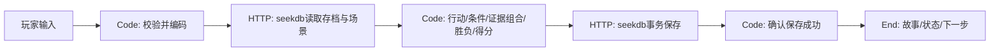

# 午夜失物招领 · Dify × seekdb

十二次行动内探索午夜车站，收集机械钟、票根和广播记录，解开失物箱取回车票。包含错误密码、线索不足、提示扣分、电量耗尽与重开结局。支持浏览器、命令行和 Dify 工作流界面；进度保存在 seekdb，服务重启后可继续。

这是 OceanBase AI 生态 Dify 题的作品，放在官方 `2026-competition-ecosystem` 基线分支的 `dify/`。玩法规则在 Dify Python Code 节点执行；后端只提供数据库读写。无需 LLM、模型提供商或付费 API Key。

## 工作流承担的核心功能



可直接导入的资产是 [midnight.yml](midnight.yml)（JSON 格式的 YAML 1.2）。`workflow/` 是 Code 节点源码，`scripts/build-dsl.py` 将其同步到 DSL。场景正文、证据文字和密码片段来自 `scenes.json` 首次初始化的 seekdb 表，每次工作流运行都实际读取。规则引擎在 Dify 中根据读取的证据组合答案。数据库不是只用于连接展示。

## 版本与资源

- Docker Engine + Compose v2，Linux x86_64（完整验收环境）。建议 4 核、8 GB 内存、20 GB 空闲磁盘。
- Python 3.10+，客户端全部使用标准库。
- Dify API / Web **1.9.1**，Sandbox **0.2.12**，Plugin Daemon **0.3.0-local**。
- seekdb **1.4.0-100000172026082615**，镜像 digest 固定在 compose 中。
- Node.js **22.16.0**，Express **5.1.0**，mysql2 **3.24.6**；依赖锁定在 `package-lock.json`。
- Postgres 15、Redis 6、Squid；实际镜像 digest 随 CI 结果保存。

## 从空目录启动

```bash
git clone --branch 2026-competition-ecosystem https://github.com/cactusprincess-hub/oceanbase-competition-2026-powercontext.git
cd oceanbase-competition-2026-powercontext/dify
python3 scripts/init-env.py
docker compose up -d --build
python3 scripts/bootstrap.py
python3 scripts/web.py
```

打开 **http://localhost:8090**。首次数据库启动需要数分钟，bootstrap 会等待就绪。`bootstrap.py` 为本作品独立的本地 Dify 创建账户、导入 DSL、发布工作流和生成应用 Key；它只连接 `127.0.0.1:5001`。密码和内部服务密钥随机生成并仅存在本地 `.env`；应用 Key 写入本地 `.runtime.json`。两者均被 Git 忽略，不要提交到仓库。

Dify 工作流编辑界面：**http://localhost:8080**，账号 `player@example.com`，密码是 `.env` 的 `DIFY_ADMIN_PASSWORD`。应用名“午夜失物招领”。在编辑器中点击运行，输入 `session_id` 和 `command` 即可；多次运行使用同一 ID。浏览器游戏会自动生成并保存独立 ID。

命令行体验：

```bash
python3 scripts/play.py
# 续接已有游戏，将页面显示的32位存档ID附在后面：
python3 scripts/play.py YOUR_32_HEX_SESSION_ID
```

## 已有 Dify 实例中手动导入

1. 启动 `seekdb` 和 `game` 服务：`python3 scripts/init-env.py && docker compose up -d --build seekdb game`。
2. 在 Dify Studio 选择“导入 DSL 文件”，上传 `midnight.yml`。
3. 设置工作流环境变量 `game_url` 为 Dify 服务器可达的数据服务地址，`game_token` 为本地 `.env` 中 `GAME_TOKEN` 的值。本文完整 Compose 部署中地址是 `http://game:3100`；已有实例需要按实际网络配置。
4. 确保 HTTP 节点的代理仅允许访问指定游戏服务。随作品提供的 `squid.conf` 只允许 `game:3100`；Code 沙箱仅连接专用隔离网络，代码节点无需网络请求。
5. 发布工作流，在工作流运行面板中输入32位小写十六进制 `session_id` 和行动指令。

## 完整游玩样例（含解谜答案）

每条命令运行一次工作流，同一局使用同一个存档 ID：

| 顺序 | command | 预期结果 |
|---|---|---|
| 1 | 开始 | 大厅，剩余12次行动 |
| 2 | 去站台 | 站台，剩余11次 |
| 3 | 查看 | 背包增加机械钟：23:17 |
| 4 | 去仓库 | 仓库 |
| 5 | 查看 | 背包增加站台编号：04 |
| 6 | 去广播室 | 广播室 |
| 7 | 查看 | 背包增加组合规则 |
| 8 | 去大厅 | 返回失物箱 |
| 9 | 打开 231704 | `status=won`，剩余4次，得分76 |

帮助、状态、背包和无效命令不消耗行动。提示消耗一次行动并扣8分。`开始` / `重来` 会清空当前局进度，历史仍保留。只知道密码但未收集三个必需证据时无法通关。十二次行动用尽且尚未开箱则 `lost`；最后一次正确开箱仍算胜利。

## 持久化与并发

seekdb 库 `midnight_game` 中：`scenes` 存场景和线索；`players` 存存档、状态与版本；`history` 存每次成功提交的指令和回复。进度更新采用版本条件，和行动记录在同一事务提交；同时运行同一存档的两个行动时仅一个写入成功，另一个明确返回冲突。HTTP 保存节点不自动重试，保存失败时工作流不会显示成功结局。

退出浏览器或运行 `docker compose restart seekdb game` 后，用同一存档 ID 可续接。`docker compose down` 保留卷；`docker compose down -v` 会删除这套独立部署的全部本地数据。重放相同指令属于新的行动，不提供跨请求去重。存档 ID 是本地游戏的访问凭证，持有者可继续该局；这是本地演示，不提供账户系统。

## 真实验收

仓库 CI `.github/workflows/dify-midnight.yml` 启动完整真实服务，执行以下命令：

```bash
docker compose exec -T game node --test tests/*.test.mjs
python3 tests/acceptance.py
```

验收使用发布后的 Dify `/v1/workflows/run`，包含完整通关、错误密码、缺失证据、失败重开、提示、独立存档、真实 seekdb 进程重启恢复。还临时把数据库中的站台编号从04改为09：原密码失败，新密码231709成功，随后恢复初始素材，证明实际数据影响玩法。验收只操作本作品的独立部署。

`results/acceptance.json` 保存实际 workflow run ID、完整故事回复、七个节点执行状态和数据库持久化快照；`results/dify-export.yml` 是真实 Dify 导出的 DSL（不含服务密钥）。CI 同时生成镜像清单。验收结果和运行链接以 `results/README.md` 为准；本地验证不等于官方得分。浏览器验收另存桌面与手机截图，并验证刷新续接。
