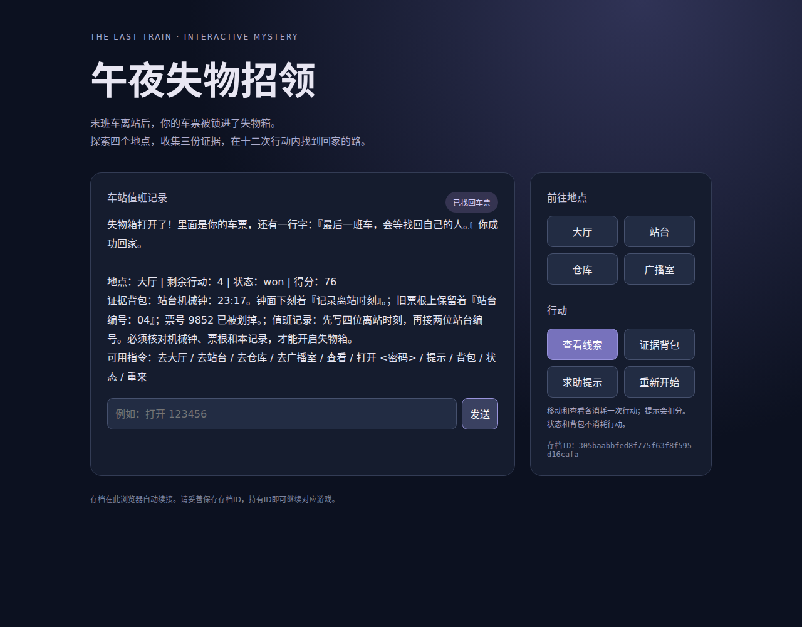

# 真实运行证据 · 2026-11-17

[GitHub Actions 完整成功运行 44006878568](https://github.com/cactusprincess-hub/oceanbase-competition-2026-powercontext/actions/runs/44006878568)

测试代码版本：`f087d8e723378a730886ff3480878a8d4c6f0222`。本目录是在该成功运行后原样下载的结果，不含本地账户密码或应用API Key。

- `acceptance.json`：37次真实Dify发布版工作流调用的输入、完整输出和run ID；通关、错误密码、证据不足、失败重开、提示、无效命令、跨进程重启恢复，以及数据库场景变化后答案变化。最后一轮的7个Dify核心节点均为`succeeded`；附seekdb存档和历史计数快照。
- `dify-export.yml`：上述真实Dify实例导出的DSL，secret环境变量留空；导入后按README配置 `game_token`。
- `browser-desktop.png` / `browser-mobile.png`：实际浏览器调用Dify通关及刷新续接后的界面；手机宽度390px，无横向溢出。
- `images.txt`：验收主机的镜像及digest清单。

同一CI也通过2个真实seekdb测试，覆盖版本冲突下单次写入、事务与历史一致、存档隔离、断线后回读、HTTP鉴权与非法进度拒绝。整次CI耗时2分38秒，独立部署在结束时销毁；截图不是长期公网服务。

本地/CI通过证明作品能复现，不代表已通过比赛人工评审或已获得20分。

